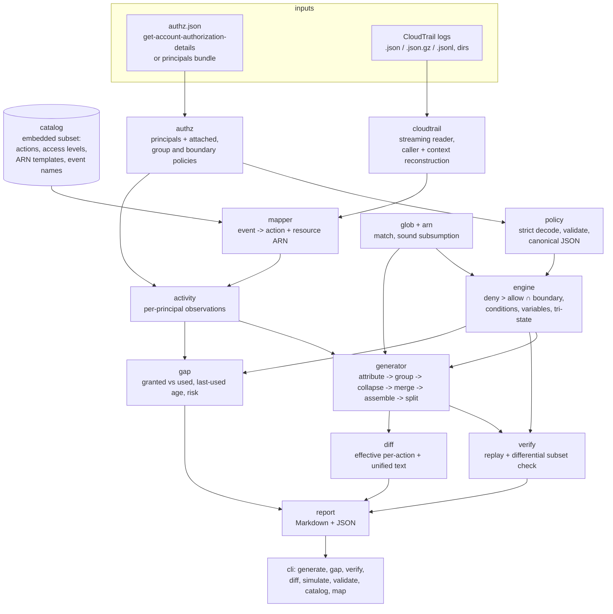

# Architecture

leastpriv is a pipeline of small, pure packages under `internal/`, wired
together by `internal/cli`. Every package except `cli`, `cloudtrail` (file
I/O) and `synth` (fixture writer) is a pure function of its inputs, which is
what makes the golden and property tests possible.

## Packages

| Package | Responsibility | Key types / functions |
|---|---|---|
| `glob` | IAM `*`/`?` wildcard matching and sound pattern subsumption; literal `*`/`?` produced by `${*}`/`${?}` are carried as private-use runes so they never act as wildcards. Tested against a regexp oracle, a subsumption soundness property test and a fuzz target | `Match`, `MatchFold`, `Subsumes`, `SubsumesFold`, `Escape` |
| `arn` | ARN parsing (6 parts; resource part may contain `:` and `/`), resource matching where wildcards in partition/service/region/account never cross a `:` | `Parse`, `Match`, `Subsumes` |
| `policy` | Strict JSON model of identity policies: exact element names, string-or-array values, `Action`/`NotAction` and `Resource`/`NotResource` exclusivity, version handling, canonical/pretty encoding, size in characters (whitespace excluded) | `Document`, `Statement`, `Validate` |
| `engine` | Policy evaluation: compiles documents once, evaluates requests with three-valued logic | `Compile`, `Set.Evaluate`, `Request`, `Decision` |
| `catalog` | Embedded action catalog with O(1) lookups: action → access level, resource types; event → actions; resource type → ARN template and CloudTrail type | `Default`, `Parse`, `Catalog.Lookup`, `Catalog.TypeOf` |
| `cloudtrail` | Streams log files (S3-delivery `{"Records":[]}`, gzip, JSON Lines, directories in lexical order); derives the calling principal (IAM user, role behind an assumed-role session, root) and the reconstructable condition context | `ReadPath`, `Record.PrincipalARN`, `Record.Context`, `Record.IsUnknownKey` |
| `mapper` | Maps a record to the (action, resource) pairs it needed authorization for, with a confidence (`exact` / `partial`) | `New`, `Mapper.Map` |
| `authz` | Loads the inventory; users inherit group policies; resolves managed policy default versions; URL-encoded documents | `LoadFile`, `Inventory.Find`, `Principal.PolicySet` |
| `activity` | Joins records, catalog and inventory into per-principal observations; counts noise (access-denied, non-principal callers, unknown services) | `Load`, `Dataset`, `Observation` |
| `generator` | Least-privilege policy generation (below) | `Generate`, `Options`, `Result`, `Split` |
| `verify` | Re-checks both invariants independently of the generator | `Verify`, `Report` |
| `gap` | Permission-gap report | `Analyze`, `Granted`, `Report`, `Status` |
| `diff` | Effective per-action diff and LCS unified text diff | `Compare`, `Unified` |
| `report` | Deterministic Markdown/JSON rendering | `GenerateMarkdown`, `GapMarkdown`, `DiffMarkdown`, `WriteJSON` |
| `synth` | Deterministic synthetic account, CloudTrail and ground truth | `DefaultConfig`, `Generate`, `Scenario.Write` |
| `evalharness` | Temporal train/test evaluation against ground truth | `Run` |
| `cli` | Commands, flags, exit codes; kept out of `main` so it is testable | `Run` |

## Evaluation engine

`engine` mirrors the IAM User Guide's evaluation logic for identity policies
plus an optional permissions boundary:

1. Implicit deny by default.
2. Any applicable `Deny` (in an identity policy or the boundary) → `explicitDeny`.
3. Otherwise `allowed` iff some identity `Allow` applies **and**, if a boundary
   is set, some boundary `Allow` applies.

A statement applies when the action matches `Action` (or is not matched by any
`NotAction`), the resource matches `Resource` (or no `NotResource`), and every
condition operator block is true. Actions compare case-insensitively,
resources case-sensitively.

**Conditions.** Operators across keys are AND, values within a key are OR,
negated operators (`StringNotEquals`, `NotIpAddress`, `ArnNotLike`…) are NOR
over values. Supported families: String (incl. `IgnoreCase`, `Like`),
Numeric, Date (RFC 3339 or epoch seconds), Bool, IpAddress (IPv4/IPv6 CIDR via
`net/netip`), Arn, Null, plus `...IfExists` and the set qualifiers
`ForAllValues:` (vacuously true on a missing key) and `ForAnyValue:` (false on
a missing key). Unknown operators are rejected at compile time.

**Policy variables.** `${aws:username}`-style variables are substituted into
`Resource` and condition values for `2012-10-17` documents (literal in
`2008-10-17`). `${key, 'default'}` defaults and the special `${*}`, `${?}`,
`${$}` are supported. Substituted text is escaped so request data can never
inject a wildcard.

**Three-valued logic.** CloudTrail does not record many context keys. A
request may mark keys as *unknown*; any condition depending on an unknown key
evaluates to `Maybe`. AND = min, OR = max, NOT swaps Yes/No and keeps Maybe.
A decision reached through a `Maybe` is reported with `Uncertain=true`, so
replay can count "allowed if the unknown values satisfy the condition"
separately instead of guessing.

The table test `TestEvaluationLogic` (67 cases) names the documentation
section each case reproduces.

## Mapping CloudTrail to IAM

For each record the catalog gives the action(s) for `(eventSource,
eventName)` (several events can map to one action, e.g. `ListObjectsV2` →
`s3:ListBucket`; one event can need several actions). For each action's
resource type the mapper resolves the ARN in this order:

1. the record's `resources[]` entries of the matching CloudTrail type;
2. request parameters that already hold a full ARN of that type;
3. the type's ARN template (`arn:${Partition}:s3:::${BucketName}/${ObjectName}`)
   filled from request parameter paths (`key`, `delete.Object[].Key` fan-out,
   SQS queue URLs parsed to names, …).

Unresolvable placeholders become `*` and the observation is `partial`; the
generator then still scopes the grant to that resource type
(`arn:aws:s3:::bucket/*`) rather than `*`.

The reconstructed request context includes `aws:CurrentTime`,
`aws:EpochTime`, `aws:SourceIp`, `aws:RequestedRegion`, `aws:userid`,
`aws:username`, `aws:PrincipalArn`, `aws:PrincipalAccount`,
`aws:PrincipalType`, `aws:MultiFactorAuthPresent`, `aws:UserAgent`,
`aws:SourceVpce`, `aws:ViaAWSService`, `aws:SecureTransport` (only from
records new enough to carry `tlsDetails`) and the S3 listing keys
`s3:prefix`, `s3:delimiter`, `s3:max-keys`; every other key (tags,
`aws:SourceVpc`, `aws:CalledVia`, service-specific keys) is unknown.

## Generation algorithm

For one principal with original policy set *O*:

1. **Attribute.** Deduplicate observations by (action, resource, relevant
   context) — only context keys the policies reference count, so timestamps do
   not explode the set. Evaluate each distinct call against *O*. Calls *O*
   denies are reported as "used but not granted" (granted elsewhere, e.g. a
   resource policy). For allowed calls pick the *source* Allow statement:
   certain matches over uncertain, conditional (narrower) over unconditional,
   then policy/statement order.
2. **Group** calls by (source statement, action).
3. **Collapse resources** per group (level-dependent, below). Every candidate
   pattern must pass `covered()`: it is provably inside the source statement's
   `Resource` via `arn.Subsumes`, or — for a `NotResource` source — is a
   literal not matched by any `NotResource` entry (wildcards are never emitted
   under a `NotResource` source). If a partially mapped resource (e.g.
   `arn:aws:s3:::b1/*`) cannot be proved inside its source, that action keeps
   the source statement's own `Resource`/`NotResource` element instead
   (reported under "fallbacks"); text copied from a `2008-10-17` source is
   escaped as in step 6 so its `${` stays literal.
4. **Collapse actions** (aggressive only): ≥ `MinActions` same-verb actions
   fold to `svc:Verb*` if the wildcard is subsumed by the source's `Action`
   and every catalog action it matches is List/Read. Expansions (actions
   granted beyond those observed) are reported.
5. **Merge** grants with equal condition and equal resource sets (union of
   actions), then equal condition and equal action sets (union of resources).
   Both merges preserve the exact set of allowed (action, resource) pairs.
6. **Assemble** Allow statements carrying the source's `Condition` verbatim,
   append the original `Deny` statements verbatim, assign Sids
   (`AllowS3`, `AllowS3N2`…). Literal `${` text from `2008-10-17` sources is
   re-escaped for the `2012-10-17` output, and observed resource names that
   contain `*`, `?` or `${` (legal in S3 keys) are written with the literal
   escapes `${*}`, `${?}` and `${$}` so they cannot act as wildcards or
   variables. Internally such names are carried as glob-escaped literals from
   step 1 on, so collapsing and subsumption treat them as plain characters.
7. **Split** (optional) into documents of at most `MaxSize` characters by
   first-fit in statement order. Identity policies combine by union and a
   Deny in any document applies to all requests, so attaching all parts is
   equivalent to attaching the whole.

### Resource collapsing

Resources of one catalog type are split into a protected prefix (everything
before the type's last placeholder, e.g. `arn:aws:s3:::acme-app-data/`) and a
variable suffix, which is inserted into a trie keyed by `/` segments.

- **exact**: no collapsing.
- **moderate** (default): bottom-up. A node becomes `path/*` when it has at
  least 3 children and each child is a leaf, an unbranched chain
  (`build-17/manifest.json`), or was itself wholly collapsed. Uniform
  partitions (date folders) therefore roll up level by level until a level is
  irregular.
- **aggressive**: top-down. The highest node with at least 2 children of any
  kind is replaced; sibling leaf names sharing a delimiter-terminated prefix
  merge (`deploy-api`, `deploy-worker` → `deploy-*`).

The root of a flat namespace (queue, function, role names — types with a
single named placeholder) is never replaced by a bare `*`.

### Why "observed ⊆ generated ⊆ original" holds

*Observed ⊆ generated.* Each allowed call is attributed to a source statement
*s*; the generated statement for its group contains the call's action (or a
wildcard covering it) and a resource pattern covering its resource, and has
*s*'s condition verbatim, so it applies to the call under the same context
whenever *s* did. The copied Denies are exactly *O*'s Denies, which did not
apply (the call was allowed). The boundary is unchanged.

*Generated ⊆ original.* Every emitted (action pattern, resource pattern) pair
is subsumed by its source statement's Action/Resource (or excluded from its
NotAction/NotResource), and the condition is identical, so any request a
generated Allow applies to is one *s* applies to. Denies and boundary are
unchanged, so nothing *O* denies can be allowed.

`glob.Subsumes` is a dynamic program, `cover[i][j]` = "general[i:] covers
specific[j:]": a `*` in the general pattern absorbs any token of the specific
pattern (including `*`), `?` absorbs exactly one non-`*` token, a literal must
align with an identical literal. It is sound (a true result is a proof) but
not complete; incompleteness only makes the generator keep a narrower pattern.

### Independent verification

`verify` does not trust the argument above; it re-checks it empirically:

- **Replay.** Every observed successful call that *O* allows is evaluated
  against the generated set (with *O*'s boundary) under the same
  reconstructed context. Failures are listed; allowances through unknown
  context are counted as uncertain.
- **Differential subset check.** A request universe = catalog actions of every
  service mentioned anywhere × resources (`*`, every observed resource, probes
  instantiated from every pattern in either policy set — wildcards replaced by
  probe text, by the empty string and by a path-crossing value — and a fresh
  resource of every catalog type per observed account/region) × contexts (all
  keys unknown, plus up to 3 observed contexts). Any request the generated set
  allows but *O* does not is a violation. Above 250,000 pairs per context the
  universe is stride-sampled deterministically and the report says so.

## Permission-gap report

For each catalog action, *granted* = some identity Allow matches the action
on some resource, it is not killed by an unconditional `Deny` on `*`, and the
boundary also allows it. Conditions are assumed satisfiable, so this is an
upper bound. Actions are then classified:

| Status | Meaning |
|---|---|
| `used` | observed within the window and within `--stale-days` of the reference time |
| `stale` | observed, but last use older than `--stale-days` |
| `unused` | granted, never observed (risk-rated: permissions-management and unscoped writes high, scoped writes and tagging medium, reads low) |
| `unobservable` | granted, but the catalog marks it as not logged by CloudTrail |
| `no-auth` | observed but requires no IAM permission (`sts:GetCallerIdentity`) |
| `used-but-not-granted` | observed success the analysed policies do not grant |

Data-event-only actions get a note asking the reviewer to confirm data events
were enabled. Grants matching services outside the catalog are listed
verbatim (e.g. `Action: "*"`).

## Diffs

- **Effective diff.** For every catalog action (plus literal actions named in
  either side), compute the (resource pattern, condition) set each side
  allows, and classify as removed / narrowed / widened / added / changed /
  unchanged using subsumption between the sets.
- **Text diff.** LCS over canonical pretty-printed JSON lines rendered as a
  unified diff; above `MaxLCSCells` it falls back to a whole-document hunk.

## Complexity

| Operation | Time | Space |
|---|---|---|
| `glob.Match` | O(p + s) typical, O(p·s) worst (greedy two-pointer, one backtrack point) | O(1) for ASCII, O(p + s) otherwise |
| `glob.Subsumes` | O(g·s) | O(s) (rolling row) |
| Evaluate one request | O(S · (A + R + C)) for S statements, A/R/C element match costs | O(1) beyond the compiled set |
| Catalog lookups | O(1) after an O(actions) index build | O(actions) |
| CloudTrail read | O(records), one file decoded at a time | O(largest file + retained observations) |
| Map one record | O(P · V) parameter paths × fanned-out values | O(V) |
| Attribution | O(E · S · m) for E distinct calls | O(E) |
| Resource collapse | O(N · L) per (source, action) group, N resources of L segments; name-prefix grouping O(K² · D) per node | O(N · L) |
| Merge + assemble | O(G log G) for G grants | O(G) |
| Split | O(S · P) size checks | O(S) |
| Verify replay | O(E) evaluations | O(distinct failures) |
| Verify differential | ≤ 250,000 pairs × (1 + 3 contexts) × 2 evaluations | O(actions + resources) |
| Gap report | O(A · S) + O(E) | O(A) |
| Effective diff | O(A · S) | O(A) |
| Text diff | O(N · M) lines, capped | O(N · M), capped |

`BenchmarkGenerateScaling` (`make bench`) measures generation end to end at
1k, 10k and 100k observations; time grows roughly linearly (see README).

## Out of scope (by design)

Resource-based policies, SCPs/RCPs, session policies, cross-account access,
`NotPrincipal`, service-linked behaviour, and the full action catalog. See
README "Limitations".
